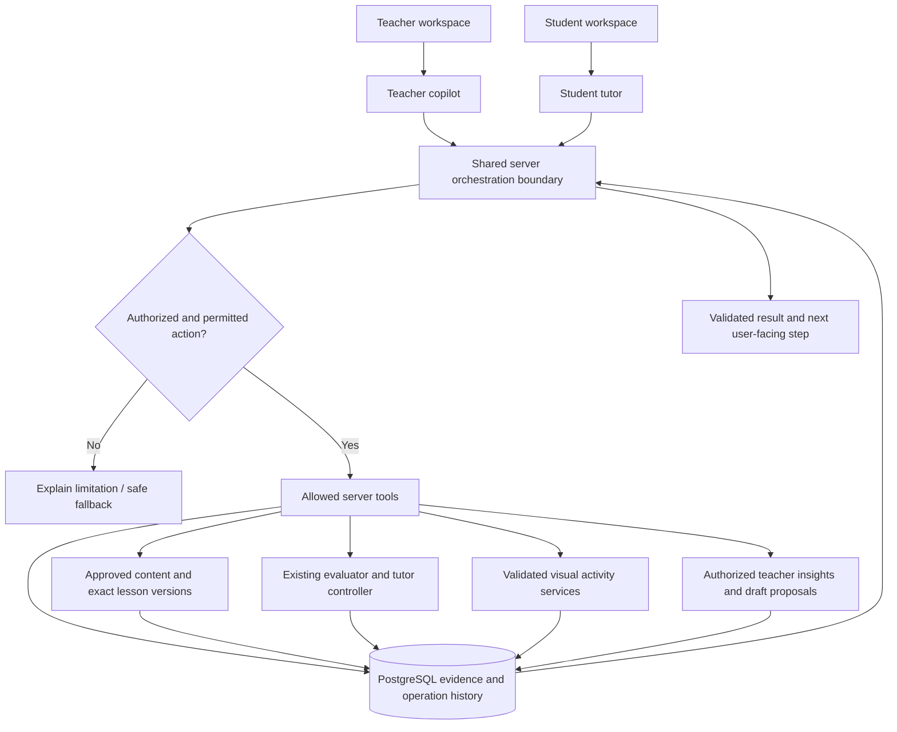
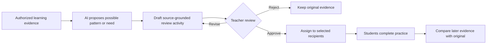

# Learning Pulse — Agentic Architecture

**Status:** Proposed design and integration contract · **Product reset:** October 22, 2026  
**Audience:** Teammates, reviewers, and coding assistants implementing the student tutor, teacher authoring, AI copilot, and learning insights.

> **Read this with [PROJECT_CONTEXT.md](../PROJECT_CONTEXT.md) and [AGENTS.md](../AGENTS.md).** This document describes the **target architecture**, not functionality already working in `main`. Do not treat diagrams, example tool names, pseudocode or fixture output as an implemented API. The existing [roadmap (#15)](https://github.com/peterbucci/ai-teaching-platform/issues/15) and [release epic (#9)](https://github.com/peterbucci/ai-teaching-platform/issues/9) still contain older scope language pending coordinated review.

## 1. Design goals and non-goals

**Goal:** Build one coherent, bounded agentic learning experience:

**Teacher supplies material → AI drafts objectives and questions → teacher approves → student converses with an adaptive AI tutor → tutor proposes and uses validated instructional tools → student response changes the next decision → evidence supports optional practice and teacher-reviewed interventions.**

The architecture must support:

1. **Teacher ownership of instruction:** Teachers can provide materials, review concepts/questions, guide the tutoring policy, and approve published lessons and official interventions.
2. **Meaningful AI decisions:** The tutor doesn't only select a prewritten branch. For at least one real-model demo path, it proposes an instructional action **based on new student evidence**, the application validates and executes the permitted action, and a later observation influences what happens next.
3. **One student conversation:** Students don't have to choose between “Ask” and “Answer” modes. The server distinguishes help from intended assessment and clarifies ambiguity before grading.
4. **Grounded, reviewable outputs:** Explanations, questions, diagrams, and interventions use the correct authorized source/version and record provenance and actual assistance.
5. **Durable, authorized state:** Retries, refreshes, timeouts, multiple tabs, concurrent teachers, and lesson revisions cannot fabricate work or overwrite historic evidence.
6. **Failure tolerance:** If generation or a visual tool fails, the saved session and deterministic curated text tutor remain usable.

**Non-goals for the hackathon:** An unrestricted autonomous agent, a complete LMS or official gradebook, arbitrary execution of AI-generated code, every document format/OCR problem, a general multi-agent framework, a new backend, a separate evaluation system, scientifically calibrated mastery scores, or automatic high-stakes decisions about students.

The project is built around **Next.js/React/TypeScript, PostgreSQL, Docker Compose, Better Auth, OpenAI APIs, and Zod**. Introduce a new dependency or system only with a concrete, reviewed reason.

## 2. What exists versus what is proposed

_Checked against current repository/PR descriptions on October 22, 2026; verify the current branch before coding._

| Responsibility | Current foundation | Additional work |
| --- | --- | --- |
| Content | Approved versioned networking package in `content/network-performance-v1/`; `lib/evidence/content.ts` | Private teacher uploads, reviewed passages, immutable reusable lesson versions, assignment-aware content resolution ([R4/#49–#53](https://github.com/peterbucci/ai-teaching-platform/issues/20)) |
| Assessment | Grounded evaluator in `lib/evaluation/evaluate.ts`; source-validated evidence contracts | Accept generated question snapshots with protected evaluation guidance; distinguish student asks from assessed answers |
| Tutor | `lib/tutoring/decide.ts` and `lib/tutoring/store.ts` provide server-controlled curated steps | Bounded AI action **proposal**, tool dispatch, outcome observation, and allowed integration with existing controller ([R7/#71](https://github.com/peterbucci/ai-teaching-platform/issues/71)) |
| Conversation | Merged `lib/dialogue/contracts.ts` / `rules.ts`; [draft PR #81](https://github.com/peterbucci/ai-teaching-platform/pull/81) adds one composer and intent contracts | Real model classification, authenticated routing, grounded replies, durable dialogue and display evidence ([#74](https://github.com/peterbucci/ai-teaching-platform/issues/74), [#75](https://github.com/peterbucci/ai-teaching-platform/issues/75)) |
| Visuals | Curated concepts and reviewed tutoring/evidence patterns | Structured visual activity generator, renderer, verified networking calculations, student prediction/explanation, tutor adaptation ([R1/#38–#43](https://github.com/peterbucci/ai-teaching-platform/issues/17)) |
| Teacher analytics | Authorized class evidence, metrics, patterns and session drilldowns | Evidence-backed new-pattern proposals (R5); AI-drafted, teacher-reviewed intervention and linked later outcomes ([R2/#44–#46](https://github.com/peterbucci/ai-teaching-platform/issues/18)) |
| Teacher interface | Assignment approval and teacher evidence pages; [draft PR #82](https://github.com/peterbucci/ai-teaching-platform/pull/82) separates workspace pages | Page-aware copilot that proposes structured draft changes and answers scoped questions about authorized evidence |

The original networking tutor is **real baseline software**, not a general agent. Existing Zod contracts for generation are **not proof** that a runtime generator or agent orchestration service has been connected.

## 3. Architecture overview



This **does not mean** the model runs the database or that every tool is exposed to both user roles. All tool invocations are server-side and filtered by the **actual actor, context, and action**. The diagram is a responsibility map, not a requirement for a new service or second state machine.

### Two role-specific agent configurations, one shared execution pattern

- **Student tutor:** Can retrieve approved student-visible passages, propose teaching actions, generate supported questions or explanations, and request validated visual activities. It cannot see teacher-only rubrics, unrelated student records, or publish class assignments.
- **Teacher copilot:** Can inspect evidence the teacher already has permission to view, propose lesson/question edits, and draft interventions. It cannot apply edits to a newer draft without a revision check, publish or assign without teacher approval, or act as another teacher.

Model instructions and tool lists are **role-scoped** and controlled by application code. The model cannot grant itself permission to call a tool.

## 4. The bounded AI decision-and-tool cycle

For each actionable interaction, use a single server-owned transaction/operation lifecycle:

1. **Authorize and anchor:** Authenticate the actor; load the authorized assignment/class, pinned lesson/source version, active attempt or teacher draft revision, current goals, and bounded relevant history.
2. **Build allowed actions:** Derive a **server-defined allowlist** from the role, lesson policy, active phase, available tools, remaining budget, and current revision. No tool becomes allowed because a model requests it.
3. **Ask for a structured proposal:** The AI proposes the student's message intent (when relevant) and/or **one useful next instructional action**, with targeted concepts and source references. Capture a short auditable reason, not hidden chain-of-thought.
4. **Validate:** Check structured schema, authorized source/version/IDs, factual grounding and answer leakage, allowed action and constraints, session/draft revision, and usage/retry policy. A citation ID matching the schema alone **does not establish factual support**.
5. **Execute the permitted tool:** The application—not model-generated code—invokes a reviewed server implementation. Generated questions and visual specs receive immutable, validated snapshots before use.
6. **Persist and deliver:** Save the request/proposal, accept/reject outcome, actual tool result, source and model/template provenance, and display/delivery event. Never treat merely generated help as help seen by the student.
7. **Observe and continue:** Student answers, student experiment results, or teacher approval become a new observation. Evaluate that evidence, choose a permitted next step, or stop with a useful summary/recommendation.

**Bounded means no uncontrolled loop.** Start with **one accepted action at a time**, using explicit user interaction or an allowed tutoring transition to continue. Keep maximum steps, model calls, tokens, timeout, concurrent requests, retry cooldown, and session usage aligned with existing `lib/dialogue/contracts.ts` limits. No automatic repeated paid calls when a previous outcome is unknown.

A failed proposal should **not** be silently substituted with a different unvalidated proposal. Display a clear limitation and use approved curated help or a safe return path. Record rejections separately from successful executions.

### Illustrative proposed action contract

This is **pseudocode for design discussion**, not an existing module or a request to duplicate the current R7 contracts:

```ts
type ProposedTutorAction = {
  action:
    | "RETRIEVE_APPROVED_PASSAGES"
    | "GENERATE_DIAGNOSTIC"
    | "GIVE_GROUNDED_EXPLANATION"
    | "PRESENT_VISUAL_ACTIVITY"
    | "OFFER_RETEST"
    | "RECOMMEND_OPTIONAL_PRACTICE";
  conceptIds: string[];
  sourcePassageIds: string[];
  parameters?: unknown; // validate with a specific Zod action schema
  reasonSummary: string; // concise audit explanation, not private model reasoning
};
```

**Required integration:** Map these concepts onto existing `ActionSchema`, R7 `DialogueRequestSchema`, `GeneratedDialogueSchema`, `QuestionSnapshotSchema`, and the current tutoring controller. Do **not** add a competing `ActionSchema` or accept arbitrary `parameters` in production. Use a discriminated union with validated parameters for each permitted tool.

### Suggested tool ownership

| Tool/capability (illustrative name) | Owner / trust boundary | Output and effect |
| --- | --- | --- |
| `retrieve_approved_passages` | Authorized content resolver; read-only | Scoped passages with stable references; can provide context, not unrestricted web browsing |
| `evaluate_answer` | Existing grounded evaluator; server gate | Accepted concept judgments and evidence for **an actual submitted answer** |
| `generate_diagnostic` | R7 grounding service and controller | Validated question snapshot, private answer criteria, citations; may enter lesson only when allowed |
| `generate_explanation` | R7 grounding service | Student-safe help with citations; log actual display before counting assistance |
| `create_visual_activity` | R1 generator, schema validator, reviewed renderer/model | Bounded activity version and allowed parameters; never generated executable code |
| `recommend_optional_practice` | R7 follow-up service | Student-visible suggestion tied to evidence; not a formal class assignment |
| `query_class_evidence` | Authorized teacher analytics | Original evidence and uncertainty within owning teacher's scope |
| `propose_draft_changes` | Teacher Copilot and draft service | Reviewable, version-anchored patch, **not an automatic publication** |
| `draft_teacher_intervention` | R2 and teacher authorization | Source-grounded proposal awaiting teacher review |

Do not implement all tools at once merely to populate an architectural registry. Start with the smallest allowed actions needed by the end-to-end demo; add R1 and R2 without replacing the core boundary.

## 5. Teacher lesson creation and copilot (R4)

```mermaid
flowchart LR
    A[Teacher uploads or pastes permitted content] --> B[Extract and review passages]
    B --> C[AI suggests concepts and objectives]
    C --> D[Teacher edits and approves]
    D --> E[AI proposes questions and rubrics]
    E --> F[Teacher or copilot revises draft]
    F --> G[Preview and explicit publish]
    G --> H[Immutable approved lesson version]
    H --> I[Assignment pinned to class]
```



### Source and lesson versioning

- **Source document identity:** Private uploaded asset, owner, declared rights, attribution, extraction method/status, file/content hash, version and page/section references when reliably available. Treat slides, documents, pasted notes and imported text as **untrusted content**.
- **Extracted passage identity:** Stable ID within a source version, text, order, provenance and integrity check. Allow human correction before approval.
- **Lesson identity:** Teacher-owned reusable lesson; an **immutable published lesson version** pins approved material versions, objectives, question bank, private rubrics, and permitted activity policy.
- **Assignment identity:** A class-specific deployment of one pinned lesson version, with teacher approval/activation, instructions, optional due date, and recipient scope. Different classes may use the same lesson version but have isolated sessions and evidence.

**Importing a source does not approve or publish a lesson. Publishing a lesson is not activating a classroom assignment.** Edits after publication create a new version; historical questions, attempts and citations remain tied to the original. A new uploaded source variant must not use fabricated Git commit identifiers.

R4's authoritative owner mapping already exists: [#49 import](https://github.com/peterbucci/ai-teaching-platform/issues/49), [#50 objectives](https://github.com/peterbucci/ai-teaching-platform/issues/50), [#51 question package](https://github.com/peterbucci/ai-teaching-platform/issues/51), [#52 publish/assign](https://github.com/peterbucci/ai-teaching-platform/issues/52), and [#53 shared content/version resolver](https://github.com/peterbucci/ai-teaching-platform/issues/53). Agree #53's minimal data interfaces early so those consumers don't build independent source stores.

### Teacher Copilot edit protocol

A teacher could say: **“Keep the same two concepts, replace the calculation question with a conceptual comparison, and add one targeted diagnostic.”**

1. Server loads the authorized **open draft** and its revision, allowed fields, approved passages and permitted concepts.
2. Copilot proposes **typed draft changes** (e.g. create/edit/remove/reorder question, change format, adjust instructions) and cites supporting source evidence as appropriate.
3. Application validates permissions, concept references, rubrics, field constraints, and question-grounding; invalid changes are rejected or flagged.
4. UI shows a **diff/preview within the current editor**. Teacher may accept selected changes, reject, revise the request, or undo a prior accepted draft change.
5. On acceptance, server checks that the draft revision still matches (optimistic concurrency). A conflicting edit requires an updated preview; never overwrite a newer teacher change.
6. Published content or official class assignments still require the normal **explicit teacher authorization**.

The copilot may also **read** authorized class metrics and original evidence, provide linked findings, and ask the teacher whether to draft an intervention. Reading teacher evidence does **not** authorize automatically sending a message, changing student classifications, or assigning work.

## 6. Single-composer student dialogue and intent routing (R7)

A student can ask about a term, ask for another example, provide an answer, or express uncertainty through **one composer**. Optional quick actions only fill editable text; they do not determine whether the message counts as an answer.

The current [PR #81](https://github.com/peterbucci/ai-teaching-platform/pull/81) proposes `lib/dialogue/conversation.ts` with `send_message`, intent proposals and clarification contracts. It is **draft UI/contracts**, not a working live classifier or storage integration.

### Routing table

| Model-proposed intent | Server behavior | Must not happen |
| --- | --- | --- |
| `ANSWER` | Confirm a clearly intended assessment response under the current question/state; use existing submission and evaluator | Grade a help request or silently replace the original attempt |
| `QUESTION_OR_HELP` | Retrieve approved passages or generate cited, permitted assistance; keep the original question open | Count it as an assessed answer or expose the hidden answer/rubric |
| `AMBIGUOUS` | Ask whether the student wants help or to submit as an answer; retain exact message and question/draft | Guess, grade, or discard the message |
| `OFF_TOPIC_OR_UNSUPPORTED` | Give a bounded redirection or an honest unsupported response | Invent citations, change topics invisibly, or grade as wrong by default |

The **model proposes** the intent using current question and bounded message history. The **server** controls which transitions may occur. Punctuation and fixed keyword heuristics are not a substitute for real intent recognition.

**Example:**

- Tutor: “A cable becomes twice as long while packet size and link rate remain unchanged. What happens to transmission and propagation delay?”
- Student: “What does packet size mean?” → **help**, not an answer.
- Tutor: Gives a grounded explanation or scaffolding without revealing an unrevealed assessment answer.
- Student: “Transmission delay stays the same because the number of bits and link rate are fixed; propagation delay increases with distance.” → **clear proposed answer**.
- Application: Uses the existing evaluation and controlled transition; preserves earlier displayed help as assistance evidence.

An ambiguous “I think it's distance, but is that right?” must not be treated as a graded attempt without clarification. When live intent recognition is down, preserve the message and use an honest confirmation/fallback; **never pretend a fixture or keyword classifier is an AI decision**.

### Generating diagnostic questions and explanations

The model can generate materially different diagnostics for different observed reasons, using approved concepts, passage IDs and validated prior evidence. A generated question needs:

- Immutable question ID, prompt, concept coverage, source version/IDs and generation provenance.
- **Server-private** answer guidance, acceptable variations and evaluation criteria, created and validated before the student answers it.
- Validation for semantic source support, conceptual fit, answerability, current tutoring scope, repetition, and answer leakage—not just JSON validity.
- A server-authorized handoff into the **existing** attempt/evaluator/controller pipeline, with accurate assistance/exposure accounting.

The model may suggest a useful instructional strategy, but it cannot self-authorize a generated diagnostic, change a student's grade/mastery/assignment, or replace an active question outside allowed transitions. All requests must be bounded and replayable without automatically purchasing another model call.

## 7. R1: validated visual teaching tool

R1 is an **agent-available instructional capability**, not a decorative animation.

The first concrete experiment can model transmission versus propagation delay. Given validated packet bits `L`, link rate `R`, distance `d`, and propagation speed `s`, reviewed application code computes:

- Transmission delay: **`L / R`**
- Propagation delay: **`d / s`**

The model may choose **when** a visual would help and propose a structured activity with permitted variables, ranges, prompts and source references. Reviewed TypeScript/server code computes the outcome, and reviewed React components display it. Never execute arbitrary generated JavaScript, HTML, SVG, shader code, or formulas from the model or uploaded content.

**Student interaction:** Predict → change an allowed variable → see the validated outcome → explain the observation → answer an independent follow-up. Preserve prediction, parameters, calculated results, visual-spec version, student explanation and exactly which assistance was displayed. The orchestrator may then choose a different permitted next step based on the **student's explanation**, not just slider usage.

**R1 ownership:** [#38 contracts](https://github.com/peterbucci/ai-teaching-platform/issues/38), [#39 renderer](https://github.com/peterbucci/ai-teaching-platform/issues/39), [#40 calculations](https://github.com/peterbucci/ai-teaching-platform/issues/40), [#41 grounded generation](https://github.com/peterbucci/ai-teaching-platform/issues/41), [#42 tutor adaptation](https://github.com/peterbucci/ai-teaching-platform/issues/42), [#43 persistence/replay](https://github.com/peterbucci/ai-teaching-platform/issues/43). Visual rendering can be developed using clearly labeled fixtures while live agent selection is being implemented.

When visual generation or rendering fails, fall back to a source-grounded text activity without losing the student's prior work. Provide an accessible text alternative and keyboard support.

## 8. R5 patterns, R2 interventions, optional practice

### R5: inspectable pattern hypotheses

A pattern analyzer may inspect authorized concept-level evaluations and exact original responses, looking for potential explanations not already represented by the reviewed categories. It must:

- Keep examples **for and against** the candidate pattern, source references, sample size and uncertainty.
- Count **distinct students**, not attempt volume, when reporting how widespread an observation is.
- Avoid confident labels of ability, motivation, disability, or permanent misconception.
- Let the teacher correct, rename, approve, or dismiss a proposed grouping before treating it as a reviewed instructional insight.

### R2: convert evidence into teacher-approved action



R2's teacher action center should preserve the **original evidence that prompted the proposal**, edited activity version, authorizing teacher, recipients, approval timestamp, delivery records, and subsequent independent/assisted work. A teacher can ask the copilot to draft the activity, but the agent **cannot** assign it or contact a student without approval.

Do not claim an intervention **caused** improvement based only on before/after observations; report what actually changed and what evidence is missing. [R2 stories #44–#46](https://github.com/peterbucci/ai-teaching-platform/issues/18) own draft, approval/assignment, and follow-up. [R5 stories #54–#55](https://github.com/peterbucci/ai-teaching-platform/issues/21) own proposed new groupings.

### Optional student practice is different

The tutor can recommend an opt-in exercise based on recorded difficulty, help requested, or an appropriate later review. It should identify the relevant objective and explain **why** it was suggested. A student accepting optional practice is not the same as teacher approval or official assignment. Preserve that distinction in both data and UI.

## 9. Storage, versioning, and evidence invariants

### Existing PostgreSQL foundation

Keep the existing profiles, classes/enrollments, assignments, sessions, attempts, evaluations, interventions, authentication, teacher metrics and evidence store. Reuse its transactions, actor-scoped authorization, idempotency and source-reference rules.

### Minimum additional records when justified

These are **proposed responsibilities**, not a mandate to create a table for every item:

| Proposed data area | Required properties |
| --- | --- |
| Uploaded source versions | Owner/access, private file pointer, hash, extraction/review status, passage IDs, attribution/rights |
| Reusable lessons and published versions | Owner, immutable approved content/source references, objectives, questions and policy |
| Drafts and copilot edit proposals | Teacher/draft IDs, expected revision, structured diff, validation, accept/reject/undo audit |
| Agent operations and tool events | Actor, session/draft, request key, expected revision, proposal, validation, actual action, result, model/template and source provenance |
| Dialogue and assistance evidence | Original message, classification and correction, question/answer linkage, accepted vs **actually displayed** help, timestamps |
| Recommendations and approved interventions | Evidence IDs, objectives, optional/student acceptance vs teacher approval, recipients and later outcome references |

Use relational integrity for identity, ownership, versions, assignments, approvals and foreign keys. Use **Zod-validated JSON/JSONB** for variable question/rubric/activity/proposal payloads where appropriate. Source-document versions and immutable lesson versions are **different entities**. Do not create an unnecessary universal concept taxonomy or dual progress store; compute authorized dashboard summaries from evidence.

### Non-negotiable evidence rules

1. **Original submissions never change:** Preserve exact student text, question snapshot, timestamps and evaluation history. A new lesson version cannot rewrite earlier work.
2. **Help is not an answer:** Asking, reading, generated clarifications and experiments have their own event identities; a student answer is an explicitly accepted assessed submission.
3. **Assistance counts when shown:** Requested/generated/accepted/displayed are distinct statuses. Unseen content is not credited as received help, and later evidence can reference help shown earlier.
4. **Model proposal ≠ action:** Store what the AI requested separately from what the server validated, executed and delivered. A model cannot mark an operation complete by asserting it happened.
5. **Revision-anchored state:** Client and provider responses must match the active assignment/source/attempt or draft revision. Stale results cannot overwrite a newer action or text.
6. **Idempotent effects:** Repeated clicks, refresh, reconnect and replay of a request key reuse the recorded accepted result rather than duplicating attempts, intervention deliveries or paid operations. Reconcile uncertain provider outcomes before a manual retry; don't promise exactly-once external billing.
7. **Honest educational metrics:** Keep independent, assisted, immediate retest and delayed independent outcomes distinct. No scientifically validated mastery/retention claim from a single interaction.
8. **Synthetic vs live demonstration:** Identify fictional seed histories separately from new real-model-evaluated interactions among fictional demo accounts.

## 10. Trust boundaries, guardrails, and fallback

| Risk | Required boundary |
| --- | --- |
| Cross-user or cross-class information | Server-side authorization for every read/write and tool execution; never trust browser-provided identifiers as permission |
| Prompt injection in uploads, readings, student text or tool results | Treat as data, never as system/developer instructions; use scoped retrieval and restricted tool allowlists |
| Private grading/rubric leak | Keep answer criteria, internal hypotheses and unrevealed expected answers server-side and absent from student payloads |
| Unsupported model explanations or citations | Validate concept scope, exact source/version/passage IDs and semantic factual support; uncertain support produces safe fallback |
| Arbitrary generated code or visual math | Structured activity specs only; reviewed React UI and server-verified calculations |
| Duplicate requests / billing / state races | Unique operation IDs, session/draft revision, DB locking/reservations, bounded explicit retries, read-only recovery |
| Overly broad agent autonomy | One bounded action at a time, server-defined permissions, teacher approval for publication/assignments, no uncontrolled loops |
| Student misclassification | Ambiguity clarification; allow correction; never automatically grade a help request |
| False improvement or diagnosis claims | Evidence and counterevidence; correct denominators; teacher interpretation and uncertainty; no unvalidated mastery or personal trait inference |
| Third-party materials or real student records | Rights/attribution checks, private files, fictional demo data only, no production-compliance claims |

**Fallback path:** Keep the curated text tutor and approved reading accessible when R7/R1/R2 services are disabled, invalid, over budget or unavailable. Failures must preserve the current question, answer draft, submitted evidence, and session history. Never silently substitute fabricated AI output or call a paid model in a retry cascade.

## 11. Integration ownership and sequencing

The GitHub project should track dependencies **by capability and acceptance gate**, not force all R1/R2 work to wait for R7 to be entirely complete.

| Capability | Primary existing issues | Suggested next integration point |
| --- | --- | --- |
| **R4 teacher material** | [#49–#53](https://github.com/peterbucci/ai-teaching-platform/issues/20) | Agree exact authorized content/version resolver in #53; parallel importer/objective/question/publish implementations |
| **R7 student dialogue** | [#71–#76](https://github.com/peterbucci/ai-teaching-platform/issues/71) | Build live intent classification and grounded generation (#74) plus durable message/evidence routing (#75) against merged contracts and draft PR #81 |
| **Bounded action orchestration** | Extend R7 planning; focused new story if needed | A single server-owned proposal/validation/dispatch mechanism shared with R1 and teacher services—not a duplicate tutor |
| **R1 visuals** | [#38–#43](https://github.com/peterbucci/ai-teaching-platform/issues/17) | #38 shared format unlocks renderer, calculations, generation and evidence in parallel; #42 connects live tutor adaptation |
| **R2 interventions** | [#44–#46](https://github.com/peterbucci/ai-teaching-platform/issues/18) | Draft from existing teacher metrics/evidence; teacher edit/approval and follow-up delivery can develop alongside R7 |
| **R5 pattern proposals** | [#54–#55](https://github.com/peterbucci/ai-teaching-platform/issues/21) | Narrow evidence-backed candidate and teacher review; independent of new visual renderer |
| **Teacher Copilot** | New focused epic/stories pending review | First structured edit of current assignment draft; later authorized evidence querying/intervention drafting |
| **Release / demo** | [#9](https://github.com/peterbucci/ai-teaching-platform/issues/9) and [#35–#37](https://github.com/peterbucci/ai-teaching-platform/issues/9) | Preserve deterministic baseline; add distinct real-model agentic demo gate and connected teacher/student workflow |

Recommended team sequencing:

1. **Reconcile plans:** Review this design with #15, #9, R4, R7, R1 and R2. Update issue scopes and ownership intentionally; do not rewrite completed history or auto-close unfinished epics.
2. **Agree shared interfaces:** Start with #53 source/lesson resolver and R7's existing dialogue contracts; add only necessary action-proposal and operation-event shapes. Coordinate `lib/evidence`, `lib/dialogue`, `lib/tutoring`, and migrations.
3. **Build in parallel:** Import/review/publish flows, live R7 intent + generated content + evidence, R1 renderer/calculations/activity generator, and R2 draft/review UI can proceed with honest fixture labels against agreed interfaces.
4. **Integrate one vertical slice:** New teacher-provided source → reviewed concepts/question → published assignment → real student interaction → permitted AI action/tool → new evidence → teacher insight and reviewed next step.
5. **Verify and deploy:** Real-model behavior, two different reasoning cases, permissions, recovery, visual/evidence integrity, teacher approval and safe fallback. Keep unsupported or unfinished portions visibly labeled.

A finished component is not the same as a finished epic. Keep statuses, dependencies, ownership, target date and **verification type** distinct on [GitHub Project #7](https://github.com/users/peterbucci/projects/7): fixture tested, real-model tested and integrated demo verified.

## 12. Demo acceptance and test strategy

**One realistic agentic showcase path must prove:**

- A teacher imports a **new, permitted** text-based reading, reviews AI-suggested objectives/question content and approves a pinned version.
- A fictional student uses **one input** to ask about a concept, receive an appropriate cited response, and later intentionally submit an answer. The help question is not graded; ambiguity is handled safely.
- Two fictional students express **different new misunderstandings** of the same concept. The model proposes **educationally different** next steps or diagnostic questions (not cosmetic paraphrases), and the server enforces allowed actions.
- With R1 enabled, the model chooses a validated visual experiment for a justified case; student prediction, action and explanation are saved and influence subsequent tutoring.
- The system proposes optional practice that is distinct from official teacher work.
- The teacher can inspect original evidence and AI decisions; with R2 enabled, an evidence-backed review draft can be edited, approved, assigned, and linked to later work.
- The Teacher Copilot can propose at least one actual structured edit to a current assignment form, with a teacher preview and explicit acceptance, when that planned slice is included.

**Verification must separate:**

| Type | What it proves—and doesn't |
| --- | --- |
| Static content checks | Schema/content integrity, not educational usefulness |
| Deterministic unit/integration tests | Correct state transitions, authorization, idempotence, math and contracts for tested cases; not live-model quality |
| Real model evaluations | Output validity, grounding, intent/action choice and educational fit for an actual configured model; not production reliability by themselves |
| Browser/database end-to-end | The real student and teacher interaction, persisted operation/evidence, authorization and recovery; not scientific learning effectiveness |

**Adversarial/edge cases:** ambiguous ask vs answer, off-topic prompt injection, malicious source instructions, unknown passage IDs, wrong lesson versions, incorrect parameter units, stale tab, refresh during accepted help, repeated Send, timeout after a paid request, failed display acknowledgement, unauthorized class access, draft conflict, and teacher rejection of an intervention. Re-run the deterministic curated flow with new reaches disabled.

Don't claim tests were executed because this document exists. Record exact model/configuration, authorized source version, fictional inputs, observed outputs, reviewer assessment, failures and untested cases in the actual demo report. Never use real student data to populate demonstrations.

## 13. Decisions and remaining questions

**Agreed direction**

- Student and teacher AI capabilities share a small, **bounded server-side execution pattern**, not a new standalone AI backend.
- The existing evaluator and tutor controller remain authoritative; the AI can propose a meaningful action, not execute one outside server permissions.
- R4 + R7 are the product-reset critical path. R1 and R2 are high-priority integrated showcase goals. R5 and a narrow Teacher Copilot slice extend the story; R3/R6 remain later.
- Teachers approve published content and official interventions; students may opt into clearly labeled optional practice.
- Content versions, student evidence, authorization, and fallback are non-negotiable.

**To resolve in focused issues/PRs**

- Exact action-proposal discriminated-union contracts and the owner of the narrow orchestrator, avoiding duplication with existing R7 contracts.
- Minimum private uploaded-source storage and reviewable extraction behavior; which additional document formats are genuinely supported.
- How an AI proposed answer intent is corrected or confirmed before irreversible assessment submission when context is uncertain.
- Which teacher form fields support copilot structured edits in the first demo and how partial accept/undo are persisted.
- When to offer optional practice, how to select a bounded review question, and how its evidence links back to the triggering session.
- The reviewed rules for offering an R1 visual versus grounded text, including the accessible fallback.
- Which class insight thresholds and student-support recommendations are defensible with fictional small-sample evidence.
- Deployment, official Canvas judging details, and the final live-model verification report before October 25, 2026.

**Bottom line:** Learning Pulse should be recognizable as an **agentic AI application because the AI interprets evidence, proposes a meaningful instructional or authoring action, uses permitted tools under server control, observes the outcome, and changes its next recommendation.** A chat window, a passing fixture, or a fixed decision tree alone does not meet that target.
